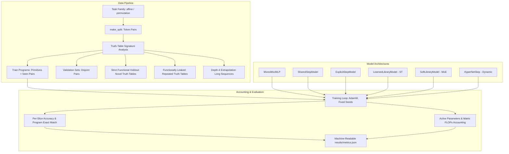

# Research Harness Architecture

This document describes the high-level architecture of the NAIR experimental harness, from synthetic task generation to split isolation and evaluation.

---

## 1. Pipeline Overview

---

## 2. Key Modules

1. **`ssnn.tasks`**: Deterministic bijections, truth-table signatures, program execution, and leakage isolation.
2. **`ssnn.models`**: Implementations of monolithic, recurrent, modular, and hypernetwork baselines.
3. **`ssnn.accounting`**: Transparent accounting of total parameters, active parameters per step, and forward/backward FLOPs.
4. **`ssnn.train`**: Reproducible training loop and multi-slice evaluation with example-level and exact-program accuracy.
